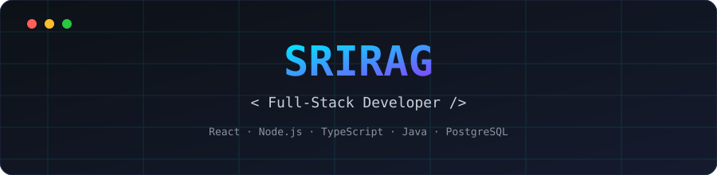
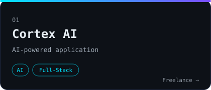
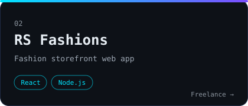
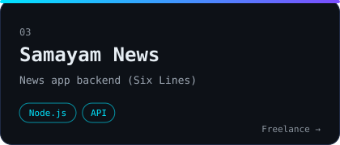
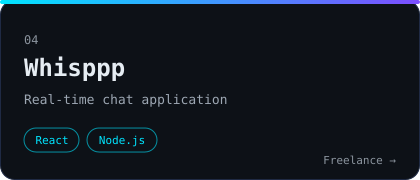
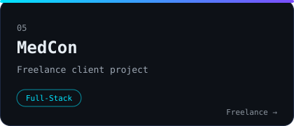

 

---

## 👨‍💻 About Me

- 🎓 B.Sc. Computer Science at the **University of Georgia, Tbilisi** (graduating March 2027)
- 💼 Full-stack developer: web apps, REST backends and payment-gateway integrations
- 🧾 Freelancing on **MedCon**, **RS Fashions**, **Samayam News**, **Cortex AI** and **Whisppp**
- 🧠 Practising **DSA** in Java: dynamic programming done, now on graphs ([Daily-DSA](https://github.com/Sriragbadveti/Daily-DSA))
- 🌱 Interested in DevOps and data science

## 🚀 Featured Projects

## 🛠️ Tech Stack

 

## 📊 GitHub Stats

## 📈 Contribution Activity

## 🐍 Contribution Snake

## 🏆 Trophies

## 🤝 Connect With Me

📧 **badvetisrirag@gmail.com** &nbsp;·&nbsp; 📞 **+91 89198 09177**

